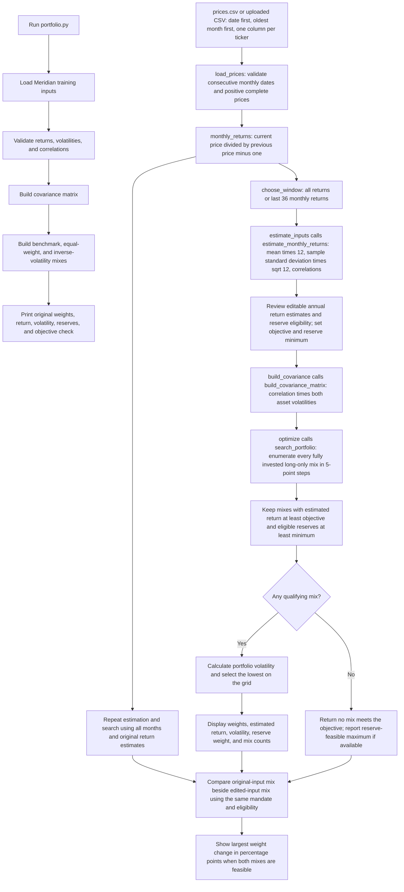

# Lab 14 — A Portfolio App a Client Could Use

Date: October 22, 2026

## Uploaded prices.csv — all months versus last 36

The objective stayed fixed at **8.00%** throughout. The reserve rule stayed
fixed at **at least 20.00% combined in LQD and TLT**, with only those two funds
ticked as reserve eligible. All weights are long-only, total 100%, and use
5 percentage point steps. No objective was lowered to obtain a mix.

The app's upload path was tested with the actual `prices.csv` contents using
Streamlit AppTest. The all-month answer was captured, the estimation-window
control was switched to Last 36 months, and the displayed results were
checked against the shared engine. This was an app test, not a browser upload.

| Answer | All months | Last 36 months |
|---|---:|---:|
| Monthly returns used | 59 | 36 |
| Return observation months | Nov 2021–Sep 2026 | Oct 2023–Sep 2026 |
| QQQ weight | 20.00% | 0.00% |
| XLE weight | 25.00% | 10.00% |
| EWZ weight | 0.00% | 0.00% |
| LQD weight | 55.00% | 80.00% |
| TLT weight | 0.00% | 0.00% |
| FBMPX weight | 0.00% | 10.00% |
| Estimated annual return | 8.31% | 8.30% |
| Annualized volatility | 11.43% | 7.40% |
| Reserve-eligible weight | 55.00% | 80.00% |
| Grid mixes tested | 53,130 | 53,130 |
| Mixes meeting both requirements | 22,829 | 36,889 |

Both windows produce a qualifying mix. The **largest weight change is LQD:
+25.00 percentage points**, from 55% to 80%. Other changes are QQQ −20 points,
XLE −15 points, EWZ 0, TLT 0, and FBMPX +10 points. A different estimation
window changes a quarter of the allocation in the largest-moving fund, even
though the mandate is unchanged. Both annual return estimates are based on
historical averages, not forecasts, and these results do not establish that
the last-36-month mix will have lower future risk.

## Discussion question — annualizing historical returns

What does `means = returns.mean() * 12` calculate, and why is it an
annualized historical estimate rather than a compound growth rate?

## Portfolio engine flowchart

### Engine connection check

The app now has an Input source selector for the six-fund CSV or Meridian
training inputs. Meridian inputs are imported from `portfolio.py` directly;
the CSV mode estimates its own correlations and does not use Meridian's table.

With a 6.5% objective and 3% reserve minimum, the verified results are:

| Test | Bills / 10-year / IG / equity (%) | Estimated return | Volatility |
|---|---|---:|---:|
| Original Meridian inputs | 0 / 20 / 25 / 55 | 6.51% | 9.44% |
| Equity return estimate reduced from 8% to 7% | 0 / 10 / 10 / 80 | 6.53% | 12.94% |
| IG–equity correlation temporarily changed from 0.25 to 0.50 | 0 / 40 / 0 / 60 | 6.52% | 9.73% |
| Correlation restored to 0.25 | 0 / 20 / 25 / 55 | 6.51% | 9.44% |

The correlation test changed both symmetric entries in `portfolio.py`, ran
the shared engine and a fresh Streamlit AppTest in Meridian mode, and verified
the displayed metrics. Both entries were then restored to 0.25, and a fresh
app test verified the original result. Browser refresh was not automated
because computer-use permissions were unavailable. The one-point equity
estimate change moves the equity weight by 25 percentage points: one quarter
of the portfolio. These are sensitivity results under training assumptions,
not forecasts.

Running `python portfolio.py` prints the original Meridian baseline comparison.
The Streamlit app uses `portfolio_core.py` as an interface to the estimation,
covariance, and grid-search functions in `portfolio.py`. This diagram shows
both entry points and the current CSV-to-answer workflow.



Annualized historical averages are return estimates, not forecasts. The local
CSV has 60 prices and therefore 59 monthly returns; last-36 mode uses the last
36 returns. The six-fund app defaults to an 8% objective and a 20% reserve floor
with LQD and TLT eligible. The Meridian CLI retains its original 6.5% objective.

## Today's goal

Today the answer lives in an app a client could use: a web page with controls, running on our own calculation engine.

Build on `portfolio.py` to answer: **Which mix carries the least risk while meeting the mandate—and does the answer survive a one percentage point change in one estimate?**

## App requirements

- Let the client adjust expected returns, the expected-return target, and the eligible-reserve minimum.
- Calculate the lowest-volatility allocation across the four supplied sleeves, with weights totaling 100% and no short selling.
- Show allocation weights, expected return, portfolio volatility, and reserve eligibility.
- Let the client select an expected-return estimate and change it by one percentage point.
- Compare the original allocation under the changed estimate with a newly optimized allocation.
- Explain when no allocation meets the selected requirements.
- Use our own calculation engine for the results and make the assumptions visible.

## Starting assumptions

All inputs are course-authored training values, not current market estimates. Returns and volatilities are annual model inputs.

| Sleeve | Expected return | Volatility | Reserve eligible |
|---|---:|---:|---|
| Treasury bills | 3.5% | 0.5% | Yes |
| Treasury 10-year note | 4.3% | 7.0% | Yes |
| Investment-grade bond fund | 5.0% | 6.0% | No |
| Global equity index fund | 8.0% | 16.0% | No |

Use the correlation matrix in `portfolio.py`. The initial expected-return target is 6.5%, and the minimum eligible reserve is 3% of the portfolio ($3 million of the initial $100 million).

## Starting result

None of the three Lab 13 baselines simultaneously meets the 6.5% expected-return target and the 3% reserve requirement.

Allowing new weights, the lowest-volatility mix under the supplied estimates and those constraints is:

| Holding | Weight |
|---|---:|
| Treasury bills | 0.0% |
| Treasury 10-year note | 3.0% |
| Investment-grade bond fund | 46.3% |
| Global equity index fund | 50.7% |

Expected return: **6.50%**. Portfolio volatility: **9.24%**. Eligible reserves: **3.00%**.

The calculation minimizes portfolio variance using the supplied covariance matrix, subject to full investment, nonnegative weights, expected return of at least 6.5%, and eligible reserves of at least 3%.

## One percentage point sensitivity test

Reduce the expected equity return from 8% to 7%, leaving volatilities and correlations unchanged. This is a one percentage point decrease, not a 1% relative decrease.

| Result | Original weights under changed estimate | Reoptimized weights under changed estimate |
|---|---:|---:|
| Treasury bills | 0.0% | 0.0% |
| Treasury 10-year note | 3.0% | 3.0% |
| Investment-grade bond fund | 46.3% | 20.95% |
| Global equity index fund | 50.7% | 76.05% |
| Expected return | 5.99% | 6.50% |
| Volatility | 9.24% | 12.54% |
| Eligible reserves | 3.00% | 3.00% |

The original allocation does not survive this change: its expected return falls below the target. Reoptimizing restores the target by increasing equity exposure, which raises modeled volatility. The base allocation has no expected-return cushion.

## Interpretation and limits

Risk here means modeled portfolio volatility, which measures return variability. It does not measure the maximum possible loss or guarantee compliance with a calendar-year loss limit.

The app should distinguish the modeled return and holdings checks from full mandate compliance. The original CPI + 4% net objective requires inflation and fee assumptions. The calendar-year loss rule needs clarification, and annual rebalancing, turnover, and ongoing payout funding require implementation evidence.

This is an educational exercise for FIN 43900 (AI Finance Applications, Purdue), not investment research or personal financial advice.

## Implementation status

This file records the Lab 14 brief and starting calculations. A local Streamlit
app is now implemented in `app.py`; see the implementation update below.

### Streamlit implementation update

Run `.venv/bin/python -m streamlit run app.py` from the course folder.
The app imports Meridian inputs and the new `search_portfolio` and
`estimate_from_csv` functions from `portfolio.py`. Existing CLI output is
unchanged. The search exhaustively enumerates fully invested, long-only
allocations in 5 percentage point steps. This is a grid optimum, distinct
from the continuous optimum recorded earlier.

The default grid optimum is 0% bills, 20% Treasury notes, 25% IG bonds, and
55% equities: expected return 6.51%, volatility 9.44%, reserve weight 20%.

CSV estimation uses simple monthly price returns, arithmetic mean times 12,
sample standard deviation times the square root of 12, and Pearson
correlations. Last-36 mode selects the last 36 returns and requires 37
prices. Dates must be consecutive months in ascending order; missing,
nonpositive, or nonnumeric prices are rejected. CSV reserve eligibility
starts unchecked because price data does not establish eligibility.

Both displayed portfolios use the current objective, reserve minimum, and
eligibility selections. The comparison preserves original Meridian
estimates or CSV estimates using all months, while the editable side uses
the selected window and edited expected returns. Largest weight change is
reported in percentage points; it is unavailable if either mix is infeasible.

Verification: original CLI output checked unchanged; CSV estimates matched
independent pandas calculations for both windows; Streamlit AppTest covered
default and edited results, infeasible objectives, CSV upload, reserve
selection, and the last-36 switch.

## Extension — Diversified Growth with a Bond Floor

The supplied extension is saved as `mandate_optimizer.py`. It uses QQQ, XLE,
EWZ, LQD, TLT, and FBMPX, with an 8% expected-return target and a minimum
20% combined allocation to LQD and TLT. Weights must total 100% and remain
nonnegative. These settings replace the four-sleeve training settings for
this extension; the earlier results above remain the original exercise.

Return estimates are annualized arithmetic averages of monthly adjusted-price
returns, and covariance is annualized from those same returns. The engine
excludes the unfinished current month, requires sufficient common history,
checks feasibility, and validates the solver result without rounding weights.

LQD holds corporate bonds; TLT holds long-duration Treasuries. The bond floor
is an allocation rule, not a guarantee of capital stability. EWZ provides
Brazil exposure rather than broad international diversification. No numerical
diversification cap is imposed by this version of the mandate.

Run from the course folder:

```sh
.venv/bin/python -m pip install yfinance scipy
.venv/bin/python mandate_optimizer.py
```

The supplied claim that these funds came from Yahoo's October 22, 2026
activity lists has not been independently verified. No downloaded results
are recorded here yet. The client-facing web page and one-point sensitivity
controls are implemented in the Streamlit app described below.


## Monthly adjusted-close price file

Download timestamp: 2026-10-22T17:22:50-04:00 (America/Indiana/Indianapolis).

`prices.csv` contains 60 monthly adjusted-close observations, October 2021 through September 2026, in USD. Columns are `Date,QQQ,XLE,EWZ,LQD,TLT,FBMPX`, oldest month first. The date is Yahoo's month-start label for the monthly bar, not the date of the closing trade. October 2026 is excluded because it is incomplete. Values are Yahoo's explicit `Adj Close` field downloaded with `auto_adjust=False`; adjustments account for distributions and splits.

Source: Yahoo Finance historical data, retrieved using yfinance 1.7.0, monthly interval. Per-fund source pages:

- [QQQ historical data](https://finance.yahoo.com/quote/QQQ/history/)
- [XLE historical data](https://finance.yahoo.com/quote/XLE/history/)
- [EWZ historical data](https://finance.yahoo.com/quote/EWZ/history/)
- [LQD historical data](https://finance.yahoo.com/quote/LQD/history/)
- [TLT historical data](https://finance.yahoo.com/quote/TLT/history/)
- [FBMPX historical data](https://finance.yahoo.com/quote/FBMPX/history/)

Validation: exactly 60 unique consecutive months, six numeric positive price columns, no missing values, and ascending dates. Reproduce with `.venv/bin/python download_prices.py` (the script refuses to overwrite an existing CSV). Sixty price rows produce 59 monthly returns. The earlier optimizer used an additional September 2021 starting price to calculate 60 returns; its previously reported estimates therefore use a slightly different window.
